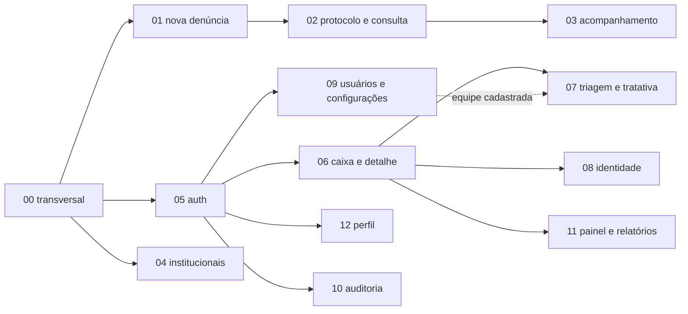

# Backlog do front-end

Tarefas para implementar o portal do denunciante e o backoffice da equipe, organizadas por área e numeradas na ordem
recomendada. Cada tarefa aponta para as tarefas do backend de que depende, pelos IDs do
backlog da API (`canal-denuncias-api/docs/tarefas/`). As decisões de arquitetura estão no
registro de decisões do projeto (D01 a D26).

## Como ler

- Cada arquivo tem o objetivo da área, as dependências no backend, as telas que já existem no esqueleto e as tarefas.
- Cada tarefa tem um ID (`PNEW-04`), estimativa, marco, dependências (do front e do backend), endpoints e critérios de
  aceite em checklist. Marque os itens ao concluir.
- **Estimativa relativa:** P (até 1 dia), M (2 a 3 dias), G (4 a 5 dias).
- **Marcos** (os mesmos do backend):
  - **MVP:** a primeira denúncia vai do envio até a conclusão.
  - **Produção:** obrigatório antes de receber denúncias reais.
  - **Evolução:** pode vir depois da entrada em produção.
- **Prefixos:** `FTRV` transversal, `PNEW`, `PACC`, `PTRK` e `PINF` no portal, `BAUTH`, `BREP`, `BCASE`, `BIDV`,
  `BADM`, `BAUD`, `BRPT` e `BPRF` no backoffice. Os prefixos do backend (`TRV`, `AUTH`, `REP`, `PUB`...) não se repetem
  aqui.

## Regras que valem para todas as tarefas

- Nenhuma requisição externa: nada de CDN, fonte, analytics ou script de terceiros (a CSP bloqueia).
- Nada em `localStorage`, `sessionStorage`, IndexedDB ou cookie legível pelo JavaScript. Estado sensível só em memória
  e limpo ao sair da tela ou encerrar a sessão.
- Protocolo, chave, relato e identidade nunca vão na URL, no título da página ou no console.
- No portal, a equipe aparece sempre como "Equipe de apuração", e as datas aparecem sem hora.
- Portal acessível conforme WCAG 2.1 AA (FTRV-07).
- A API é a autoridade nas permissões: esconder um botão no front é conveniência, não controle de acesso.

## Índice

| #   | Arquivo                                                                                | Área                                 | Tarefas | MVP    | Produção | Evolução |
| --- | -------------------------------------------------------------------------------------- | ------------------------------------ | ------- | ------ | -------- | -------- |
| 00  | [00-transversal.md](00-transversal.md)                                                 | Transversal (`@canal/shared`)        | 11      | 10     | 0        | 1        |
| 01  | [01-portal-nova-denuncia.md](01-portal-nova-denuncia.md)                               | Portal: nova denúncia                | 8       | 6      | 2        | 0        |
| 02  | [02-portal-protocolo-e-consulta.md](02-portal-protocolo-e-consulta.md)                 | Portal: protocolo e consulta         | 4       | 3      | 1        | 0        |
| 03  | [03-portal-acompanhamento.md](03-portal-acompanhamento.md)                             | Portal: acompanhamento               | 4       | 3      | 1        | 0        |
| 04  | [04-portal-paginas-institucionais.md](04-portal-paginas-institucionais.md)             | Portal: páginas institucionais       | 4       | 1      | 3        | 0        |
| 05  | [05-backoffice-auth.md](05-backoffice-auth.md)                                         | Backoffice: autenticação             | 8       | 7      | 1        | 0        |
| 06  | [06-backoffice-caixa-e-detalhe.md](06-backoffice-caixa-e-detalhe.md)                   | Backoffice: caixa e detalhe          | 6       | 5      | 1        | 0        |
| 07  | [07-backoffice-triagem-e-tratativa.md](07-backoffice-triagem-e-tratativa.md)           | Backoffice: triagem e tratativa      | 8       | 6      | 2        | 0        |
| 08  | [08-backoffice-identidade.md](08-backoffice-identidade.md)                             | Backoffice: identidade               | 4       | 0      | 4        | 0        |
| 09  | [09-backoffice-usuarios-e-configuracoes.md](09-backoffice-usuarios-e-configuracoes.md) | Backoffice: usuários e configurações | 8       | 5      | 3        | 0        |
| 10  | [10-backoffice-auditoria.md](10-backoffice-auditoria.md)                               | Backoffice: auditoria                | 2       | 0      | 2        | 0        |
| 11  | [11-backoffice-dashboard-e-relatorios.md](11-backoffice-dashboard-e-relatorios.md)     | Backoffice: painel e relatórios      | 4       | 1      | 2        | 1        |
| 12  | [12-perfil.md](12-perfil.md)                                                           | Backoffice: meu perfil               | 3       | 2      | 1        | 0        |
|     |                                                                                        | **Total**                            | **74**  | **49** | **23**   | **2**    |

Estimativas: 37 P e 37 M.

## Ordem de implementação

O front pode começar antes da API ficar pronta, usando o documento OpenAPI e respostas simuladas nos testes. Cada
etapa abaixo só fecha quando as tarefas do backend da coluna da direita estiverem prontas.

| Etapa | Front                                                                                                  | Espera do backend                                                                                                                |
| ----- | ------------------------------------------------------------------------------------------------------ | -------------------------------------------------------------------------------------------------------------------------------- |
| 1     | Base: FTRV-01 a FTRV-04, FTRV-09, FTRV-10                                                              | TRV-01, TRV-07, TRV-08, TRV-11, AUTH-07                                                                                          |
| 2     | Portal, envio: PINF-01, PNEW-01 a PNEW-06, PACC-01                                                     | CAT-01, REP-01, REP-02                                                                                                           |
| 3     | Portal, acompanhamento: PACC-02, PACC-03, PTRK-01, PTRK-02, PTRK-04                                    | PUB-01 a PUB-03, MSG-01, MSG-02                                                                                                  |
| 4     | Backoffice, acesso: BAUTH-01 a BAUTH-07, BPRF-01, BPRF-02                                              | AUTH-01 a AUTH-06, USERS-07                                                                                                      |
| 5     | Backoffice, equipe: BADM-01 a BADM-05                                                                  | USERS-02 a USERS-06                                                                                                              |
| 6     | Backoffice, tratativa: BREP-01 a BREP-04, BREP-06, BCASE-01 a BCASE-06, BRPT-01                        | REP-03, REP-04, CASE-01 a CASE-07, MSG-03, MSG-04, ACL-02, ACL-03                                                                |
| 7     | Qualidade do MVP: FTRV-05, FTRV-06, FTRV-07, FTRV-11                                                   | Ambiente com a API do MVP rodando                                                                                                |
| 8     | Produção: anexos, identificação, identidade, auditoria, indicadores e o restante marcado como Produção | ATT-01 a ATT-04, IDV-01 a IDV-06, AUDIT-06, AUDIT-07, REPT-01, REPT-02, CAT-02, CAT-03, RET-03, RET-04, PUB-04, AUTH-08, CASE-08 |

## Dependências entre áreas

## Marco do MVP

Alinhado ao MVP do backend: a primeira denúncia vai do envio até a conclusão, pelas telas.

1. O ADMIN criado pela CLI entra no backoffice com senha e MFA (BAUTH-01 a BAUTH-05) e cadastra um gestor e um
   analista (BADM-01 a BADM-04). Os dois trocam a senha provisória e cadastram o MFA no primeiro acesso (BAUTH-03,
   BAUTH-04).
2. O denunciante lê o início (PINF-01), preenche o wizard (PNEW-01 a PNEW-05), revisa, envia (PNEW-06) e guarda o
   protocolo e a chave (PACC-01).
3. O gestor vê a denúncia na fila de triagem (BCASE-01), abre o detalhe (BREP-02), atribui ao analista e define a
   prioridade (BCASE-02, BCASE-03).
4. O analista lê o relato, escreve uma pergunta (BREP-04) e muda para "Aguardar denunciante" (BCASE-04).
5. O denunciante consulta com protocolo e chave (PACC-02, PACC-03), vê "Aguardando sua resposta" e responde (PTRK-01,
   PTRK-02).
6. O analista registra notas (BCASE-05) e conclui com desfecho (BCASE-04). O denunciante vê a denúncia como concluída,
   com o desfecho (PTRK-01).

**Ficam fora do MVP**, como no backend: anexos, identificação opcional, revelação de identidade, trilha de auditoria
na tela, indicadores e as páginas de privacidade e ajuda com texto definitivo. Durante o MVP, o wizard não mostra as
etapas de anexos e identificação.

**O MVP não vai para produção.** Antes de receber denúncias reais, todas as tarefas do marco Produção precisam estar
prontas, principalmente o aviso de privacidade validado (PINF-02).

## Pendências do esqueleto

| Pendência                                                                                   | Tarefa   |
| ------------------------------------------------------------------------------------------- | -------- |
| CSP e Trusted Types conferidos só com `curl`, nunca num navegador real                      | FTRV-05  |
| `TODO: authGuard` em `projects/backoffice/src/app/app.routes.ts`                            | BAUTH-05 |
| XSRF não é enviado no docker compose local, porque a API fica em outro domínio              | FTRV-04  |
| O `apiInterceptor` envia cookies também no portal, que não deveria enviar                   | FTRV-03  |
| Playwright não roda no Ubuntu 20.04: os testes de ponta a ponta precisam rodar em container | FTRV-06  |

## Fora do escopo

- Proteção contra spam e denúncias abusivas no portal: captcha, proof-of-work e afins (decisão D15).
- Cadastro ou login de quem denuncia (decisão D16).
- Contato com o denunciante por e-mail ou telefone (decisão D06).

## Pontos em aberto

| #   | Ponto                                                                                                                                                                                                            | Onde                      |
| --- | ---------------------------------------------------------------------------------------------------------------------------------------------------------------------------------------------------------------- | ------------------------- |
| 1   | Gerador do cliente da API: `orval` ou `ng-openapi-gen`                                                                                                                                                           | FTRV-01                   |
| 2   | Estado: `@ngrx/signals` (SignalStore) ou serviços com signals                                                                                                                                                    | FTRV-10                   |
| 3   | Vale extrair os textos para i18n agora, com só o português?                                                                                                                                                      | FTRV-08                   |
| 4   | O gestor precisa listar os analistas para atribuir, mas USERS-03 é só do ADMIN. Falta no backend um endpoint de analistas disponíveis para a denúncia (ou liberar a listagem filtrada para `COMPLIANCE_MANAGER`) | BCASE-02, CASE-03         |
| 5   | O front mostra as transições permitidas copiando a tabela de CASE-01. Melhor seria a API devolver `allowedTransitions` no detalhe (REP-04), para as regras ficarem num lugar só                                  | BCASE-04, REP-04          |
| 6   | Mensagens novas: botão de atualizar (proposta atual) ou busca periódica                                                                                                                                          | PTRK-02, BREP-04          |
| 7   | Não há endpoint para gerar novos códigos de recuperação do MFA: hoje só o reset pelo ADMIN (USERS-06) resolve                                                                                                    | 12-perfil, USERS-06       |
| 8   | Biblioteca de gráficos compatível com a CSP estrita e Trusted Types                                                                                                                                              | BRPT-03                   |
| 9   | Herdados do backend: regra para usuário desativado com denúncias atribuídas (USERS-04), efeito da mudança de retenção (CAT-03) e tipos de anexo aceitos (ATT-01)                                                 | BADM-03, BADM-06, PNEW-07 |
